作品编号： （必须填写系统自动分配的编号）

作品类别： □软件设计   □硬件制作   □工程实践
☑密码应用技术  □其它

2026年第十一届全国密码技术竞赛作品设计报告

作品题目：
衍枢 GridEpoch——面向海量配电终端的纪元式批量密钥管理系统

2026 年 10 月 12 日
中国密码学会

基本信息表
编号：
作品题目：衍枢 GridEpoch——面向海量配电终端的纪元式批量密钥管理系统
作品类别：□软件设计   □硬件制作   □工程实践  ☑密码应用技术  □其它
作品内容摘要：针对新型电力系统中百万至千万级配电终端密钥逐台下发耗时长、吊销后仍要让漏收终端跟上、主密钥与设备私钥不宜放在同一进程的问题，本作品设计并实现了“衍枢 GridEpoch”纪元式批量密钥管理系统。业务随机数不下台区：台区能认证并打开控制，算不出电能量密钥，也伪造不了 62 字节完成帧。无吊销时节点 1 一条完全子树；整区、整县、整批各收成一条子集差。漏收中间纪元的在册终端仍打开最新广播。吊销、销毁和确认失败改的不是同一份状态。集中器不另建密钥树，只转发本台区的省级切片。系统以纪元为轮换单位。每一纪元新生成两个 16 字节随机数，主密钥不随纪元更换。无吊销时，终端报文 236 字节、网关报文 216 字节、吊销根 118 字节，完成帧固定 62 字节；有吊销时整包随覆盖条数增长，终端靠 Merkle 只取盖住自己的一条。管控链止于台区，业务链不到台区。纪元报文由 SM2 协同签名保护，调用方分片与服务进程分片都不能单独签名。主密钥与这两个随机数另行做 2-of-3 门限托管，与协同签名不是同一套分片。接入认证用 SM9 标识签名，只对照公开示例。完成帧另核终端对标签的 SM9 签名，核验失败则不接受这 62 字节，这次核对不进入百万台更新。值班台覆盖灌装、接入核验、吊销、换表、割接、销毁、归档审计和固件召回。本机实测 1000 万台密钥流式派生 0.637 秒（15,704,440 台/秒），百万台对称更新 1.391 秒，百万台确认重算 0.749 秒。逐台 SM2 加密下发的本机估算为百万台约 1.4 小时，约为对称更新的 3600 倍。截图中的 `make test` 为 43 项，全部通过。
关键词（五个）：批量密钥管理；纪元轮换；子集差吊销；分级加密；SM2协同签名


1.作品功能与性能说明
1.1 需求背景与设计目标
随着新型电力系统建设持续推进，配电自动化终端、智能电表、集中器、台区融合终端等设备规模已达百万至千万级。海量终端的密钥管理面临三重矛盾：
1. 下发效率与终端规模的矛盾：若沿用逐台 SM2 加密下发工作密钥的方式，本机单次约 5.0 ms，一百万台约 1.4 小时，难以赶上批量轮换和故障处置的时限；
2. 吊销与漏收并存的矛盾：失陷终端必须退出下一轮密钥，停电或漏收的在册终端又不能因为缺了中间某一份就永远追不上；
3. 密钥材料过于集中的矛盾：省级签名分片、两把主密钥和终端设备私钥若放在同一进程，一次失陷就会同时暴露签名能力和设备私钥。
针对上述矛盾，本作品提出并实现了“衍枢 GridEpoch”纪元式批量密钥管理系统，设计目标如下：
1.一轮轮换、一份广播：以纪元为轮换单位。省级签发一份广播，终端用灌装时的长期密钥打开最新纪元，在本地派生工作密钥。终端种子按身份确定性派生，主站不保存千万把种子；
2.吊销可收束，终端只收一条：无吊销时用完全子树，节点 1 一条密文。整区、整县、整批各收成一条子集差。散点吊销的覆盖族随形状增长；纪元头上的 Merkle 使每台终端只核对并打开盖住自己的那一条；
3.进程分开、两套分片分开：协同签名由调用方分片 d1 与服务进程分片 d2 共同完成。主密钥和纪元随机数用另一套 2-of-3 门限封存。产线持有设备私钥，地市打不开灌装包，保管进程只收第三份分片；
4.全生命周期管理：覆盖终端灌装、接入核验、吊销、换表、割接、销毁、归档审计与固件召回。确认失败只记未跟上，不自动吊销。
本作品对应赛题 A1-6《电力领域海量配电终端批量密钥管理方案设计实现》，方案要点与赛题要求逐条对应：
赛题要求	本方案
不少于 1000 万台终端的密钥管理	终端树 2^28、每台区 2048 槽，按 10 万台区编址；种子流式派生、不落库。基准在每个台区派生 100 台，共 1000 万台
密钥层级不少于 2 级，支持分级认证加密	省、地市、县、台区、终端。台区能认证并打开控制，打不开电能量
不少于百万级终端并行密钥更新	100 万台处理同一份广播上的对称计算；确认按台区收成 62 字节，主站按业务主密钥流式重算
在密码算法分工上：业务加密采用 SM4，杂凑与密钥派生采用 SM3，纪元报文仅携带一份 SM2 协同签名；接入认证采用 SM9 标识签名，不进入百万台更新；更新确认采用业务密钥标签，由台区聚合成固定长度后交主站重算。
1.2 系统功能
功能模块	功能说明
纪元密钥轮换	每一纪元生成认证、业务两个 16 字节随机数，主密钥保持不变。漏收中间纪元的终端凭最新广播进入当前纪元，旧纪元报文拒绝
分级认证	终端以认证密钥响应挑战，台区以管控链重算校验。认证随机数可以下到台区，业务随机数不下到台区
分级加密	电能量用业务密钥做 SM4，台区打开失败，省级可以解开。控制用控制密钥，台区和省级都能打开
子集差吊销	无吊销走完全子树；有吊销走子集差。整区、整县、整批各一条密文。网关换槽不轮换台区管控密钥
主密钥托管	两把主密钥与 SM9 主私钥、以及每个纪元的两个随机数，各自在 GF(256) 上做 2-of-3。页面用两份口令打开，不回传随机数；第三份在保管进程，可以替换其中一份口令
SM2 协同签名	纪元报文由 d1 与 d2 交互签名。任一份额签不出已公布公钥能接受的签名。这套分片不用于恢复主密钥
SM9 接入核验	新终端以标识签名完成接入核验。核验通过不改变当前纪元，签名材料不进入后来的纪元报文
全生命周期管理	值班台支持灌装、接入核验、吊销、换表、割接、销毁、归档审计、固件召回。销毁不把叶子放进吊销集；确认失败不自动吊销
完成帧确认	台区收齐在册终端的 16 字节业务标签后异或，上送 62 字节完成帧。主站用业务主密钥重算。不一致则拒绝并给出台区内明细，吊销集不变。终端对标签的 SM9 签名核验失败时，这 62 字节也不接受
1.3 主要性能指标
在 Apple Silicon（ARM，10 线程）单机环境下实测，数字与图 3-5 为同一轮输出。测试条件详见 3.1 节。这些是本机吞吐，不是广域网时延，也不是 1000 万台物理终端同时在线。
性能指标	实测数值	说明
密钥流式派生	0.637 s，15,704,440 台/秒	10 万台区 × 100 台 = 1000 万台，不落库
4 进程扇出派生	0.177 s，5,646,052 台/秒	100 万台。本机 4 进程，不是地市广域网
省级组包	32.8 ms	三份报文各一次 SM2 协同签名，并带上这一纪元的门限托管
单份终端报文验签	5.66 ms	SM2 验签，30 次平均，不放进百万次循环
百万台对称更新	1.391 s，718,663 台/秒	分摊每台约 13.9 μs，只含打开 SM4 密文和派生两把工作密钥
百万台确认重算	0.749 s，1,334,283 台/秒	完成帧 62 字节，标签不落库
千万台确认重算	7.614 s，1,313,455 台/秒	—
逐台 SM2 下发（对照）	单次 5.0 ms，百万台约 1.4 小时	本机估算。仓库另一组参考测量约 1.8 小时
百万台对称更新 1.391 秒，相对逐台 SM2 下发的约 1.4 小时，约为 3600 倍。省级组包和确认重算另计，不把三步相加后再写成同一个倍数。

2.设计与实现方案

2.1 实现原理
2.1.1 总体架构
运行时有八个实体、五个操作系统进程。五个进程是值班台、地市进程、产线进程、协同签名进程和保管进程。台区和终端是密钥持有者，演示里不单独占进程。县密钥在地市进程内派生，不另起县进程。主站是省级软件密码模块，不是硬件密码机。

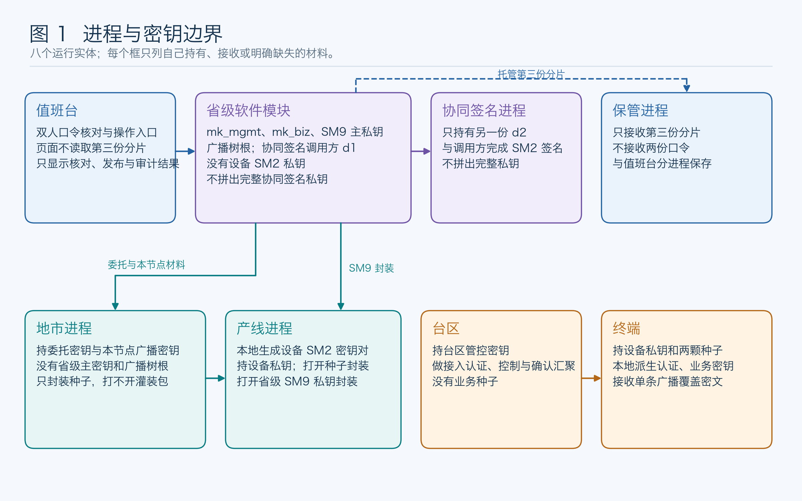

图 2-1　进程与密钥边界。省级没有设备私钥；地市没有主密钥和广播树根，只封装种子；产线在本地打开封装；保管进程只接收第三份分片；协同签名两边都不拼出完整私钥。
进程	职责
grid_epoch.console	值班台（http://127.0.0.1:8765）。操作入口、双口令核对和审计。页面不读取第三份分片，恢复时不回传随机数
grid_epoch.kmc	省级软件模块，与值班台同进程。保存两把主密钥、SM9 主私钥、协同签名调用方分片 d1 和广播树根。签发纪元头，重算确认标签。不生成设备私钥
grid_epoch.city_server	地市进程。持有本节点广播密钥、管控委托、业务委托和一张范围令牌。分配叶子，封装两颗种子，自己打不开灌装包，也不核对完成帧
grid_epoch.factory	产线进程。生成设备 SM2 密钥对，只把公钥送给地市。在本地打开种子封装和 SM9 封装
grid_epoch.cosign_server	协同签名进程。只持有 d2。没有 d1，不保存种子，不保存主密钥
grid_epoch.custodian	保管进程。只接收门限的第三份分片，不接收口令，目录与值班台分开
省级广播根下用固定 16 位等长路径，容纳 65536 个地市槽，任何一个地市都不是另一个地市的祖先。县密钥从地市委托向下派生，推不出地市，也推不出兄弟县。SM9 用户私钥由省级封给设备公钥，明文不进入地市；地市和网关持有的是 SM9 主公钥。
2.1.2 两条派生链
层级是省、地市、县、台区、终端。管控链到台区为止。业务链从县业务密钥直接到终端种子，不到台区。县序号由注册槽除以县宽得到。台区槽不少于 512 时县宽为 256。台区号 42 不是县序号。

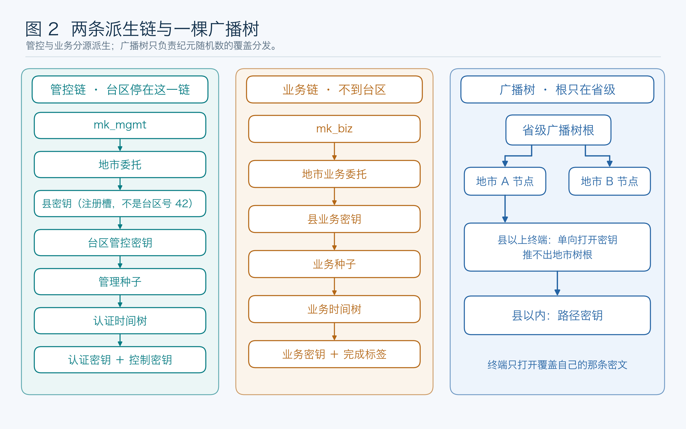

图 2-2　管控链、业务链和广播树。广播树只负责把纪元随机数封进覆盖密文，不代替这两条派生链。
派生使用 SM3-KDF，字节布局以 `grid_epoch/derive.py` 为准：

```text
city_mgmt   = KDF(mk_mgmt ‖ "CITY" ‖ 簇号, 32)
city_biz    = KDF(mk_biz  ‖ "CIBZ" ‖ 区域 ‖ 簇号, 32)
county_mgmt = KDF(city_mgmt ‖ "CNTY" ‖ 县槽号, 32)
county_biz  = KDF(city_biz  ‖ "CNBZ" ‖ 县槽号, 32)
zone_mgmt   = KDF(county_mgmt ‖ "ZONE" ‖ 区域 ‖ 台区号, 32)
seed_mgmt   = KDF(zone_mgmt ‖ "MGMT" ‖ 终端号, 32)
seed_biz    = KDF(county_biz ‖ "BIZ0" ‖ 台区号 ‖ 终端号, 32)
```

管理种子再沿认证时间树走到该纪元的认证叶子，业务种子沿另一棵时间树走到业务叶子。两棵树的高度都是 16。工作密钥为：

```text
认证密钥 = KDF(认证叶子 ‖ "AUTH" ‖ 纪元号 ‖ 认证随机数, 16)
控制密钥 = KDF(认证叶子 ‖ "CTRL" ‖ 纪元号 ‖ 认证随机数, 16)
业务密钥 = KDF(业务叶子 ‖ "BIZK" ‖ 纪元号 ‖ 业务随机数, 16)
```

纪元 0 只用于灌装，不能承载业务。从纪元 1 起，每轮新生成两个 16 字节随机数，主密钥不更换，否则以后的新终端无法派生。网关明文是 `纪元号 ‖ 认证随机数`，20 字节。终端明文是 `纪元号 ‖ 认证随机数 ‖ 业务随机数`，36 字节，只出现在终端覆盖集里。终端先验 SM2，再核对自己那一条覆盖，然后才打开随机数。漏掉中间纪元可以直接进入最新纪元；纪元号不大于已接受纪元号的报文拒绝。
每 65536 个纪元为一代。进入一代的最后一个纪元时，用 `KDF(当前叶子 ‖ "NEXT")` 留下下一代的根，再抹掉能推出过去的节点。这是终端侧的前向安全：从这颗芯片读不出已经跳过的认证密钥和业务密钥。主站在窗口内留着两棵时间树的根和每个纪元的两个随机数，仍能重算。窗口结束后删掉在线随机数，该纪元不能从在线状态重算；当前纪元不受影响。删掉在线随机数不是在线主站已经前向安全。路径密钥不随纪元删除。
2.1.3 灌装
产线生成设备 SM2 密钥对，只把公钥送给地市。地市分配叶子，封装管理种子和业务种子，自己不打开。省级把 SM9 用户私钥封给同一把设备公钥，明文不进入地市。产线在本地打开两份封装。SM9 只用于接入认证，不进入后来的纪元报文。

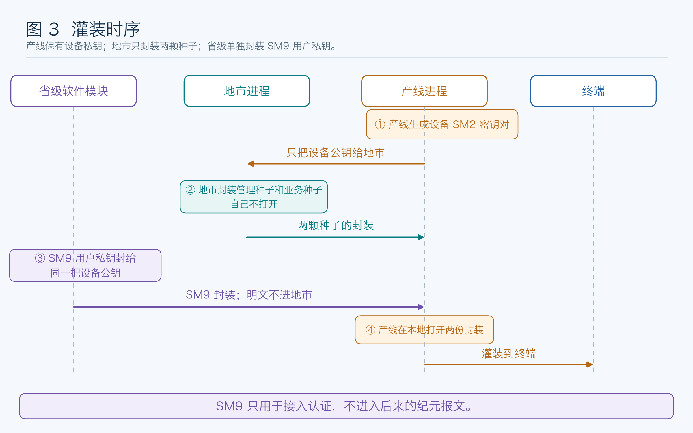

图 2-3　灌装时序。设备私钥只在产线生成；两颗种子的明文不进地市；SM9 用户私钥的明文也不进地市。
2.1.4 覆盖、吊销与终端打开
终端组织为 2^28 叶子的逻辑密钥树，叶子按台区半开区间 `[台区序号 × 2048, 下一台区)` 分配。供货批次是其中对齐的 64 叶，也是固件召回单位。县是连续 256 个台区槽。用过的槽位留在吊销集里，不回收。网关树为 2^19 叶子，每台区 4 个槽，换槽不复用，也不轮换台区管控密钥。
覆盖来自 Naor、Naor 与 Lotspiech 的无状态广播加密：接收方用自己保存的密钥打开一份签名广播，不依赖上一份是否收到。本方案保留这一点，并改了三处。空吊销用完全子树；完整的行政切割收成一条子集差；终端用长期路径密钥打开最新一份，漏收的中间纪元不用补齐。逻辑密钥层次要成员在线逐跳更新，漏一份就追不上，不适合停电后补抄 [5]。IEC 62351-9:2023 的组密钥用 GDOI，成员要与密钥服务器交互 [6]。千万终端、窄带或停电后补抄，不把这两种当作更新通道。

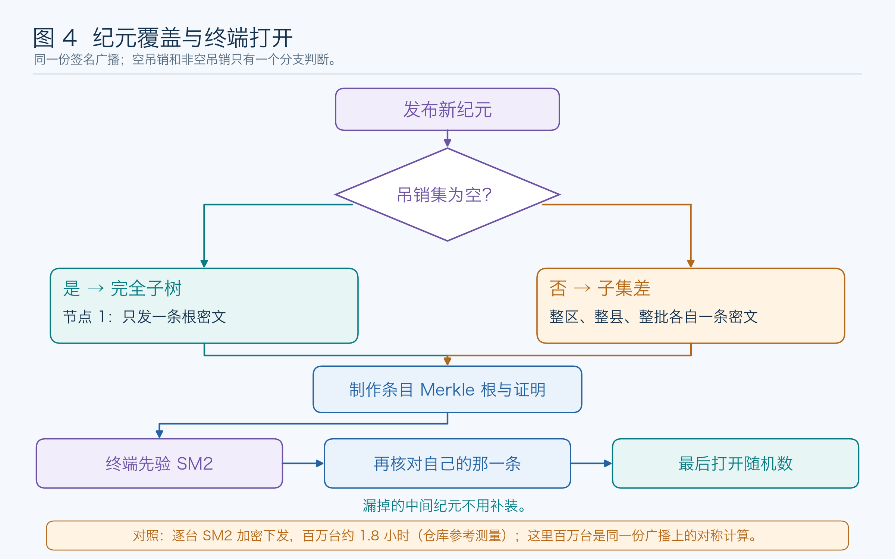

图 2-4　纪元覆盖与终端打开。空吊销和非空吊销只在覆盖算法上分支，签名广播仍是一份。
空吊销时，覆盖集是节点 1 的一条完全子树密文。县以上只保存单向打开密钥：

```text
打开密钥 = KDF(节点密钥 ‖ "CSOP", 16)
```

它能解开节点 1 的空覆盖，推不出子节点，因此终端路径里没有地市树根。无吊销时终端报文仍是 236 字节，网关报文 216 字节，吊销根 118 字节。
吊销集非空时改用子集差。记 u 为被摘掉的行政节点，v 为其中仍要保留的后代，则

```text
S(u, v) = {u 的后代叶子} ∖ {v 的后代叶子}
```

整区、整县、整批各是一条密文。没有占满一个批次的坏表仍用子集差，条数随坏表的形状变化；单叶吊销时覆盖族为 O(log N) 条。这个 O(log N) 是整包里的覆盖族规模。终端侧因为条目 Merkle，始终只收到并打开盖住自己的一条。1000 条覆盖时，终端切片为 545 字节。集中器不另建密钥树，也不打开明文，只转发叶子落在本台区的省级切片和原来的证明。整区被摘掉时，邻区收到的就是那一条。被排除的叶子即使握有路径上的完全子树密钥，也解不开对应密文。
终端保存的子集差悬挂标签数量是 `log N × (log N + 1) / 2`。这个数量按树高累加，不等于路径上的节点密钥个数。子集差标签从地市树主密钥用 `SDLB` 导出，不从 `NODE` 路径密钥推出。
AEAD 从覆盖密钥再派生两把 16 字节密钥 `AENC` 和 `AMAC`，密文布局是 `iv ‖ 长度 ‖ 密文 ‖ MAC`。
值班台点吊销时，纪元号不变，吊销版本递增，页眉按新的吊销集显示完全子树或子集差。新的 118 字节吊销根要到下一次发布才重新签名。已经发出的旧吊销根配上新纪元会被拒绝。确认失败不修改吊销集。
2.1.5 协同签名与门限托管
这两套机制保护的材料不同，恢复路径也不同。
纪元报文上的 SM2 由调用方分片 d1 和服务进程里的 d2 经管道交互生成。调用方没有 d2，服务进程没有 d1，两边都不拼出完整私钥 d。公钥按

```text
P = [d2^{-1}][d1^{-1}]G − G
```

计算。输出的 `r‖s` 能被普通 SM2 验签接受。单独一份分片签不出这把公钥能接受的签名。GM/T 0144-2025 的公开页面没有算法步骤，工作区内也没有正文，因此这套乘法分片不标成符合 GM/T 0144。
主密钥托管是另一件事。两把主密钥和 SM9 签名主私钥接成 96 字节，每个纪元的两个随机数接成 32 字节。各自在 GF(2^8) 上做成一次多项式：

```text
f(x) = s + a x，约化多项式 x^8 + x^4 + x^3 + x + 1
份额为 f(1)、f(2)、f(3)。任意两份恢复 s，单独一份不行。
```

口令甲、口令乙各封装 f(1) 和 f(2)，写在值班台目录。f(3) 的明文只交给保管进程。页面恢复只用两份口令，只显示某一纪元的托管包是否打开，不回传随机数，也不读取第三份。保管进程里的第三份可以替换其中一份口令。在线主站打不开这份托管包。这是托管，不是在线前向安全。
2.1.6 分级加密与完成帧
终端打开本纪元的两个随机数之后，报文分成电能量、控制、确认三条路。上行服务号为 GE01 和 GE03，不解析 DL/T 帧。GE01 是电能量，用业务密钥，台区打开失败，省级可以解开。GE03 是控制，用控制密钥，台区和省级都能打开。

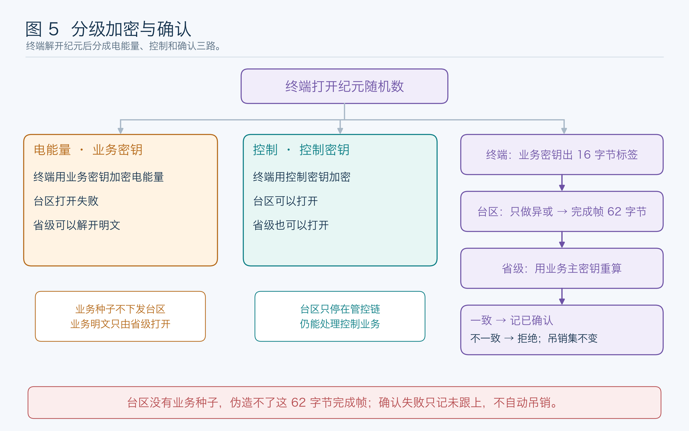

图 2-5　分级加密与确认。台区停在管控链上，仍能处理控制；电能量和完成标签都要用到业务链。
完成标签用业务叶子，不用管控密钥：

```text
K_ack = KDF(业务叶子 ‖ "ACKK" ‖ 纪元号 ‖ 业务随机数, 16)
标签  = HMAC-SM3(K_ack, "ACK1" ‖ 台区号 ‖ 终端号 ‖ 纪元号) 的前 16 字节
```

台区没有业务种子，也没有业务随机数，算不出这个标签，因此伪造不了 62 字节完成帧。它先核一条用认证密钥做的 `ACK0`，辨认发送者，再把 16 字节标签收下来。同一终端两次标签不同，这台退出本轮聚合。缺席终端不拿全零充数。
全部到齐时上送完成帧 ZALL：台区号、纪元号、台数、16 字节异或、链路 MAC，共 62 字节。主站用业务主密钥重算该台区全部在册终端的异或。一致才记入当前纪元的已确认集合。不一致则一台都不记，只向这个台区要明细。扣下一个在册序号时，完成帧被拒绝，明细点出这个序号，吊销数不变。未到齐时可以上送差额帧，只确认报文里证明得了的那一部分。链路 MAC 只证明帧来自这个台区。
终端再用 SM9 对完成标签签名，台区收成 Merkle 根。这份签名不替换 62 字节完成帧：帧仍是异或，长度仍是 62 字节。核验失败则主站不接受这 62 字节。这次核对不进入百万台更新。
接入认证的标识是 `GEID ‖ 区域 ‖ 台区 ‖ 台区内序号`。终端对 `ENR1 ‖ 挑战 ‖ 终端号 ‖ 纪元` 做 SM9 标识签名。代码对照的是公开示例，未对照 GM/T 0044.2-2025 全文，不写成已经符合该标准。核验通过只登记身份，不改变当前纪元。
2.1.7 叶子的六种归宿
在册叶子之后有六种结果，确认失败不是其中的吊销态。

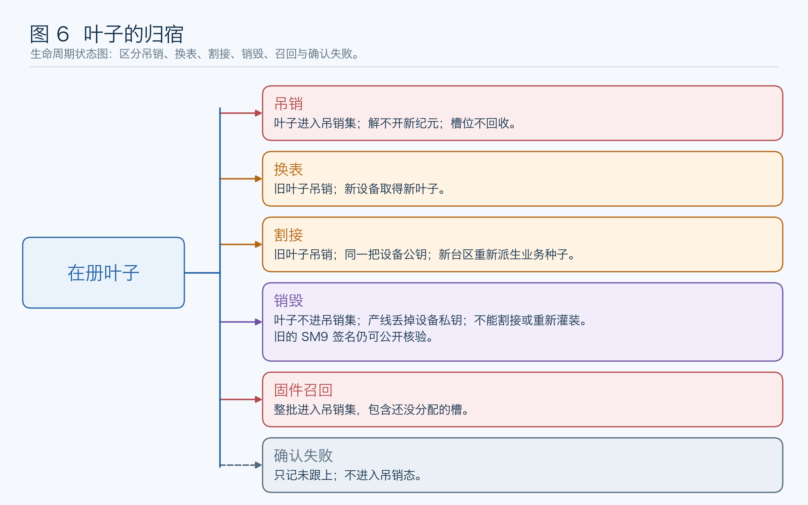

图 2-6　叶子的归宿。吊销、换表、割接、销毁、固件召回和确认失败改的不是同一份状态。
吊销把该叶子放进吊销集，终端解不开新纪元，槽位不回收。换表吊销旧叶子，新设备取得新叶子。割接吊销旧叶子，同一把设备公钥在新台区重新派生业务种子。销毁不把叶子放进吊销集；产线丢掉设备私钥，之后不能割接，也不能重新灌装；已经签出的 SM9 签名仍可用公开验证函数核对。固件召回把整个批次放进吊销集，包含还没分配的槽。确认失败只记未跟上。
在册终端重新灌装时，管理种子按台区管控密钥重新导出，与原先一致，认证证明不变。网关吊销只作废当前网关槽，下一槽交给新网关，台区管控密钥不变。
2.1.8 报文长度
报文	无吊销时的长度	保护	用途
终端报文	236 字节	一份 SM2 协同签名，覆盖密文为 SM4-AEAD	下发两个纪元随机数。有吊销时整包变长，终端切片仍是一条
网关报文	216 字节	一份 SM2 协同签名	下发纪元号和认证随机数
吊销根	118 字节	一份 SM2 协同签名	锚定吊销版本。吊销集不变则不重签
完成帧	62 字节	业务标签的异或，加链路 MAC	在册集合确认。长度不随台区人数增长
三份纪元报文各签一次，省级组包里的“3 次 SM2”是这三份，不是终端报文上签三次。签名只覆盖带头：魔数、版本、区域、簇、纪元、时间戳、吊销版本、覆盖种类、条目数和 32 字节 Merkle 根。无吊销时长度与终端总数无关。有吊销时整包随覆盖条数增长；终端收到的切片不随终端总数增长。
2.1.9 软件实现与代码结构
系统以 Python 实现。SM3、SM4 与批量派生由 `native/` 加速。模块按职责划分如下。
路径	内容
grid_epoch/derive.py	密钥派生的字节布局。评审对公式时看这里
grid_epoch/ack.py	完成帧、差额帧和明细帧
grid_epoch/sdkey.py	子集差标签，不经过 NODE 路径密钥
grid_epoch/sm9id.py	接入认证的 SM9 标识签名，对照公开示例
grid_epoch/tree.py	逻辑密钥树的覆盖集
grid_epoch/subtree.py	按台区区间单调分配的长期子集密钥
grid_epoch/package.py	纪元头签名、覆盖条目 Merkle、终端切片
grid_epoch/city.py	地市委托密钥、注册、吊销和组包
grid_epoch/city_server.py	地市进程：不打开灌装包，也不装入省级主密钥
grid_epoch/factory.py	产线进程：设备私钥和种子只在这里打开
grid_epoch/custodian.py	保管进程：只接收第三份分片，不接收口令
grid_epoch/session.py	值班台用来连接地市进程和产线进程
grid_epoch/desk.py	值班台操作：发布、吊销、销毁、归档、召回
grid_epoch/services.py	GE01 电能量和 GE03 控制
grid_epoch/device.py	终端 SM2 灌装封装
grid_epoch/console.py	本机值班台页面
grid_epoch/kmc.py	省级软件模块边界、纪元签名、确认核验
native/	SM3、SM4 和批量派生
源码、测试和基准脚本见仓库 https://github.com/munos1233/grid-epoch 。现行设计说明是 `docs/方案设计.md`。`docs/优化方案.md` 与 `docs/第二轮优化.md` 是修订档案，不作为现行口径。本报告图 3-5 的数字来自该次 `make bench` 的终端输出；仓库 README 中的另一组数字是另一次测量，量级相同，以当次输出为准。
2.2 运行结果
本节按真实操作展示值班台。演示用的是小树：台区 42、43、44 各 4 台。容量指标仍以终端树 2^28、每台区 2048 槽为准，不以这 4 台为规模。页眉显示当前纪元、完全子树或子集差，以及三份报文的 SM2 验签。图 2-6 的六种叶子归宿分别对应后面的吊销、换表、割接、销毁和召回；确认失败对应扣下序号后的那一帧。
（1）纪元发布与台区确认。初始状态下纪元未发布，台区 42—44 各有 4 台在册（图 2-7）。发布纪元 1 后，三份报文 SM2 验签通过。吊销集为空，覆盖为完全子树（图 2-8）。台区 42 四台全部确认后，完成帧为 62 字节（图 2-9）。

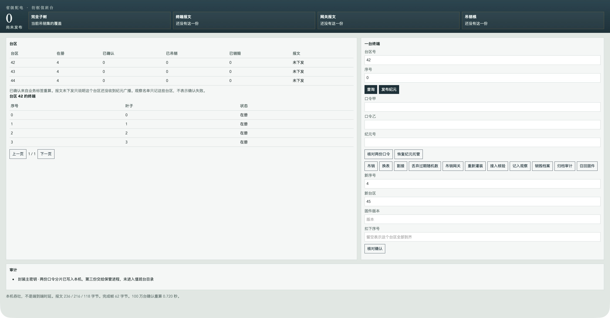

图 2-7　值班台初始状态：纪元未发布，台区 42—44 在册就绪

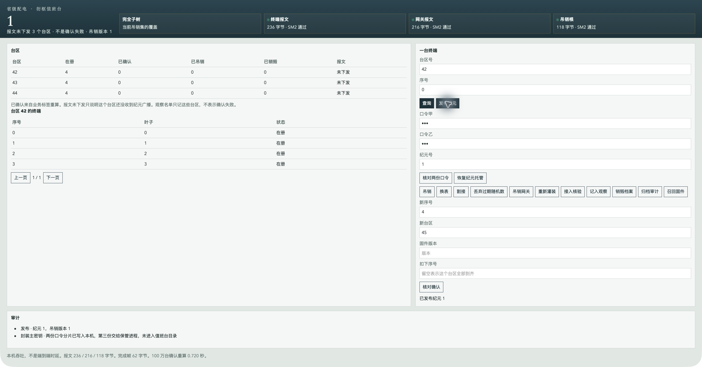

图 2-8　发布纪元 1：三份报文 SM2 验签通过，完全子树覆盖

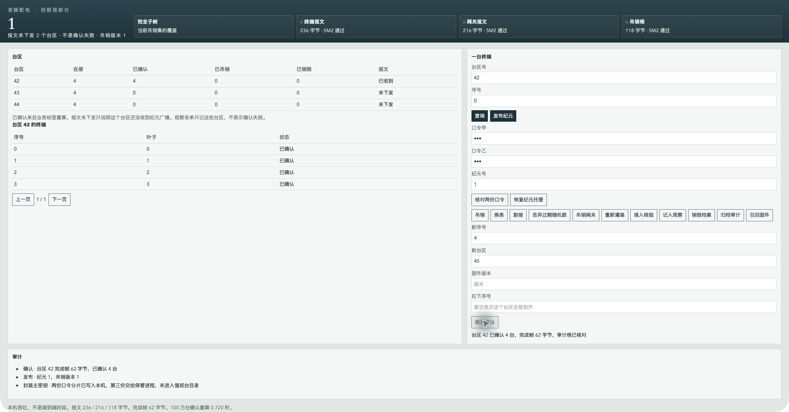

图 2-9　台区 42 四台确认，完成帧 62 字节
（2）双口令与托管恢复。错误口令打不开（图 2-10）。两份口令核对通过后才能继续（图 2-11）。恢复纪元 1 时，页面只显示托管包已经打开，不回传随机数（图 2-12）。丢弃过期随机数后，该纪元不能从在线状态重算，当前纪元仍为 1（图 2-13）。

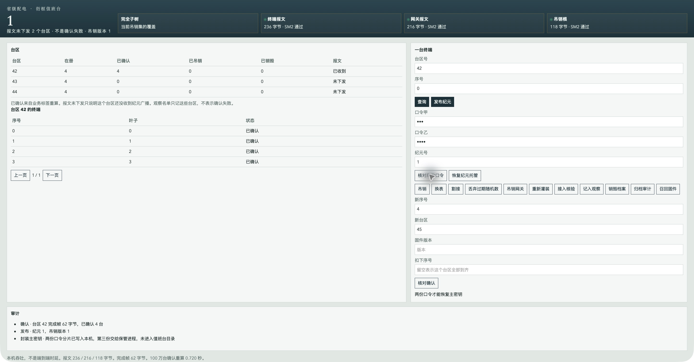

图 2-10　错误口令核对失败

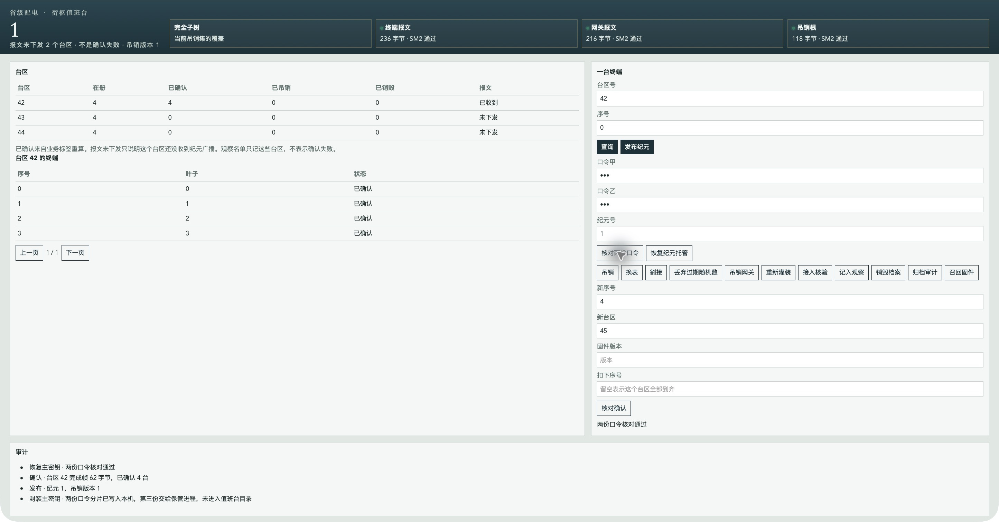

图 2-11　两份口令核对通过

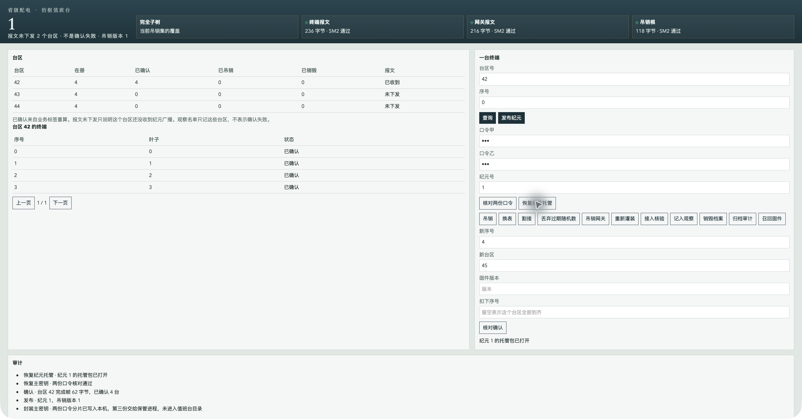

图 2-12　恢复纪元 1 的托管包：只显示打开，不回传随机数

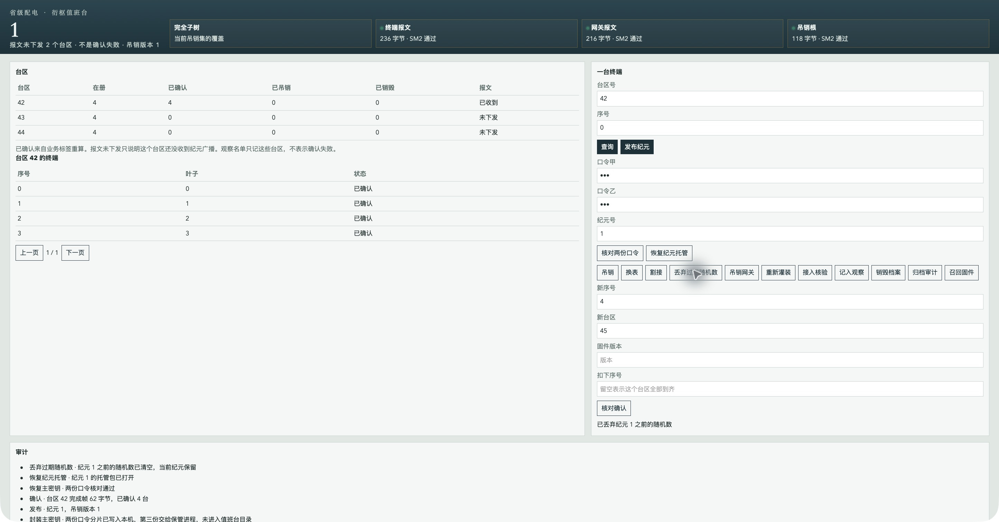

图 2-13　丢弃过期随机数后，当前纪元仍为 1
（3）SM9 接入核验。核验通过只登记身份，纪元号不变（图 2-14）。

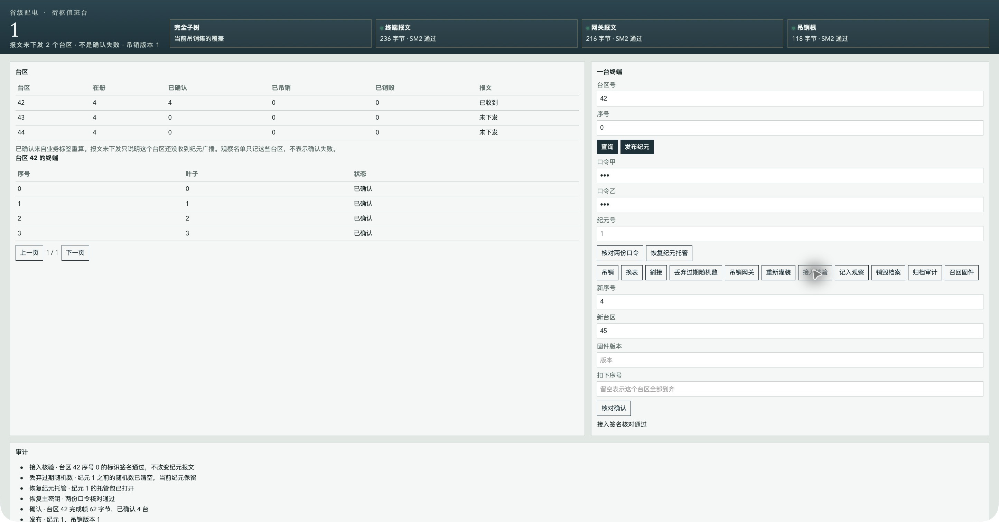

图 2-14　SM9 接入核验通过，纪元不变
（4）扣下、吊销、观察名单与网关换槽。序号 1 被扣下、尚未吊销时，完成帧因标签与在册集合不一致被拒绝，吊销集不变（图 2-15）。正式吊销序号 1 后，覆盖改为子集差，台区 42 在册减少、已吊销增加（图 2-16）。观察名单只做记录，不参与验签，也不表示确认失败（图 2-17）。吊销网关时槽位被替换，台区管控密钥不轮换（图 2-18）。

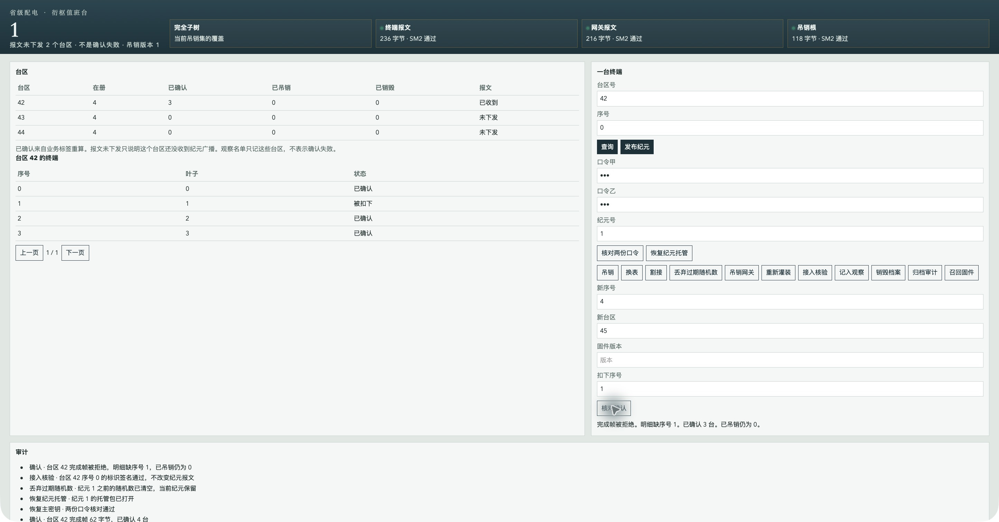

图 2-15　扣下序号 1：完成帧被拒绝，吊销集不变


图 2-16　吊销序号 1：子集差覆盖，在册减少

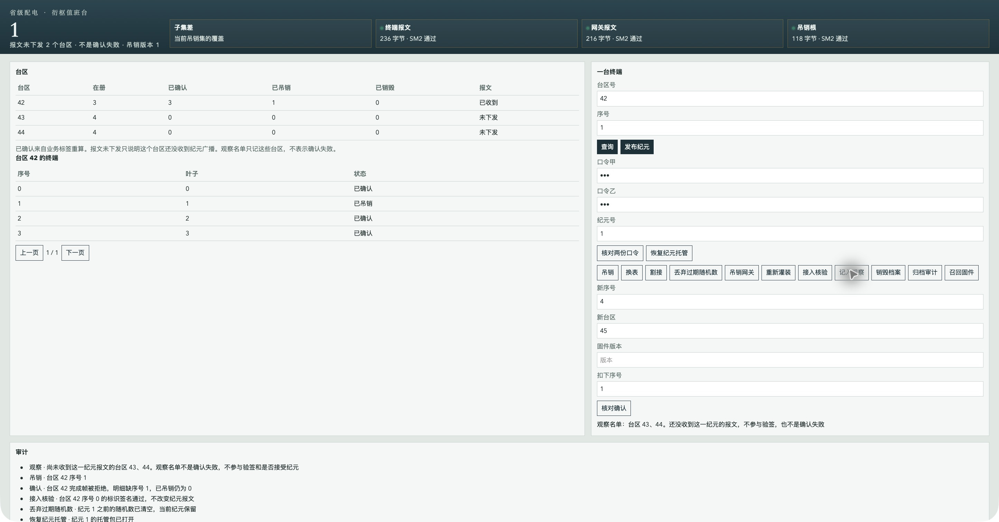

图 2-17　观察名单只做记录，不参与验签


图 2-18　吊销网关：槽位替换，管控密钥不轮换
（5）换表与割接。换表后新终端得到新序号 4 和新叶子 4。旧表解不开新纪元，邻表仍用灌装时的路径密钥进入最新纪元（图 2-19）。割接到台区 45，新序号为 5；同一设备公钥在新区重新派生业务种子（图 2-20）。


图 2-19　换表：新序号 4，新叶子 4

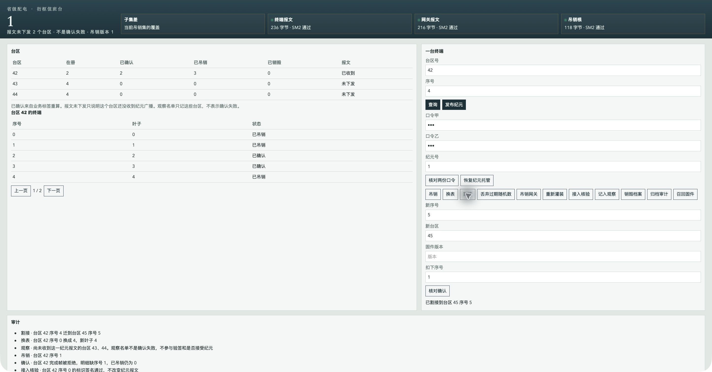

图 2-20　割接到台区 45，新序号 5
（6）销毁、归档与重新灌装。销毁后叶子号保留，不进入吊销集，在册减少（图 2-21）。查询结果行标记为已销毁（图 2-22）。销毁后接入核验失败（图 2-23），重新灌装被拒绝（图 2-24）。归档后热表保留最新一条（图 2-25）。尚未销毁的在册终端可以重新灌装，管理种子与原先一致（图 2-26）。


图 2-21　销毁档案：叶子保留，在册减少


图 2-22　查询已销毁终端，结果行标记已销毁

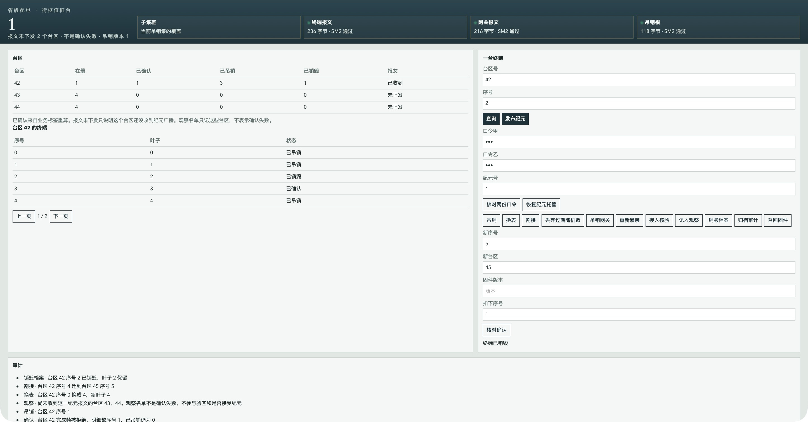

图 2-23　销毁后接入核验失败


图 2-24　销毁后重新灌装被拒绝

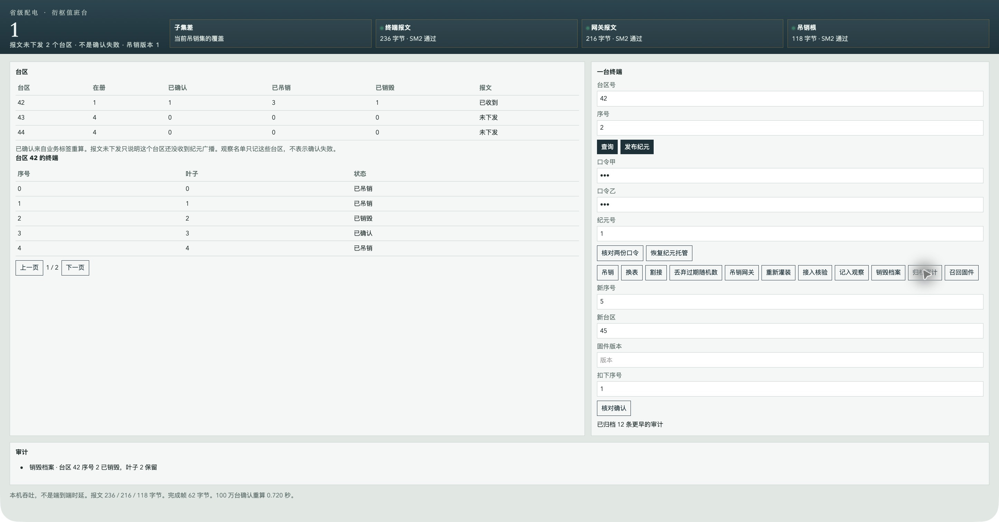

图 2-25　归档审计：热表保留最新一条

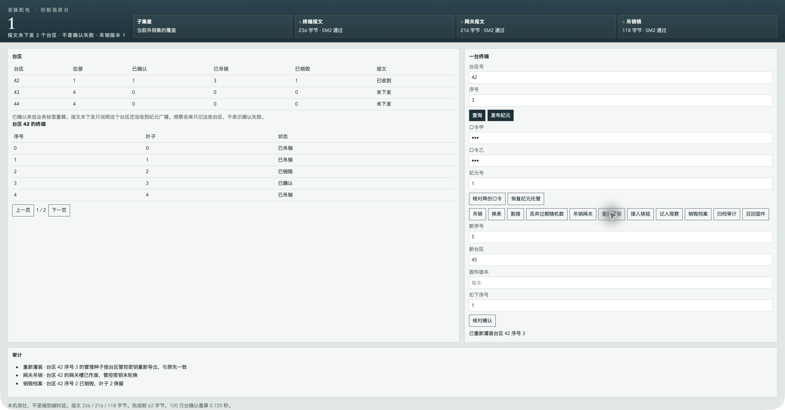

图 2-26　在册终端重新灌装，管理种子与原先一致
（7）固件召回。固件版本填 1。版本 1 是出厂版本，这一次召回把该台区仍为版本 1 的四个批次全部摘进吊销集，包含这些批次里尚未分配的槽。四个批次互不重叠，覆盖收成 1 条子集差（图 2-27）。这一步放在最后，因为它会摘掉该台区的出厂批次。

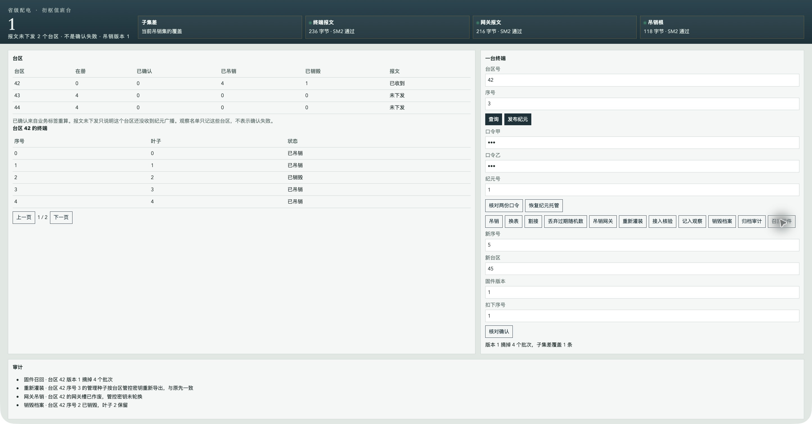

图 2-27　召回固件版本 1：四个批次进入吊销集，子集差 1 条
2.3 技术指标
指标类别	指标项	指标值
容量指标	编址规模	终端树 2^28 叶子，每台区 2048 槽，按 10 万台区使用
容量指标	本机派生规模	1000 万台（10 万台区 × 100 台），种子不落库
容量指标	网关树	2^19 叶子，每台区 4 槽，用过不复用
报文指标	无吊销时的三份报文	236 / 216 / 118 字节
报文指标	完成帧	62 字节
报文指标	1000 条覆盖时的终端切片	545 字节
性能指标	密钥流式派生	1000 万台 0.637 s（15,704,440 台/秒）
性能指标	省级组包	32.8 ms（三份报文各一次 SM2 协同签名）
性能指标	百万台确认重算	0.749 s（1,334,283 台/秒）
安全指标	纪元签名	SM2 协同签名，d1 与 d2 都不能单独签名
安全指标	主密钥与随机数	GF(256) 上的 2-of-3。两份口令可打开，第三份可替换其中一份
安全指标	接入核验	SM9 标识签名，对照公开示例，核验不改变纪元
安全指标	业务保护	电能量用业务密钥，台区打不开；完成标签同样用业务叶子
可靠性指标	自动化测试	图 3-6：Ran 43 tests，OK
2.4 适用界限
演示中的主站是软件密码模块，不是硬件密码机。纪元广播只签 SM2。真实性由这份签名承担，机密性是 SM4-128。第二种签名不参与密钥封装，窄带报文不叠，没有把未实现的抗量子签名写成已经具备。协同签名不标成符合 GM/T 0144，SM9 不标成符合 GM/T 0044.2-2025 全文。不实现 Q/GDW 376.1 帧和 DL/T 帧。确认失败不自动吊销。性能数字是这一台机器上的派生、更新和确认重算，不是端到端时延，也不是 1000 万台物理终端。4 进程扇出是本机进程，不是地市之间的广域网。邻居若主动转发业务随机数，终端可以自己算出业务密钥；这是威胁边界，不另做原语去堵。

3.系统测试与结果

3.1 测试方案
测试环境：macOS（Apple Silicon，ARM，10 线程），单机五进程（console、city_server、factory、custodian、cosign_server），值班台地址 http://127.0.0.1:8765 。图 3-5 与图 3-6 为这次提交所用的终端输出。
测试方法分为四层：
1.算法正确性：SM3、SM4 用国家标准测试向量核对，AEAD 做往返和篡改检测，流密钥做异或一致性比对；
2.自动化测试：`make test`。图 3-6 的结果是 Ran 43 tests，OK，用时 18.000 秒；
3.端到端场景：`make demo` 走灌装、分级认证、电能量、离线直达、吊销、确认和换表。`make split` 把主站与终端分进程，再看吊销后的旧表和新表；
4.规模基准：`make bench` 测量千万级派生、百万级对称更新和确认重算，并给出逐台 SM2 的本机估算。
SM3、SM4 的向量对应 GM/T 0004、GM/T 0002。纪元报文的验签使用 SM2。协同签名和 SM9 的边界见 2.4 节，不把未读到的标准正文写成已经符合。
3.2 功能测试
`make demo` 中，纪元 0 不能承载业务。激活时的三份长度仍是终端 236 字节、网关 216 字节、吊销根 118 字节。台区以管控链重算认证。电能量由终端业务密钥做 SM4，主站解开上行明文，台区派生业务密钥被拒绝（图 3-1）。控制报文用控制密钥，台区可以打开；这条分工见图 2-5。步骤 4 中，漏掉纪元 1 的终端凭最新广播进入纪元 2，旧纪元报文被拒绝（图 3-2）。

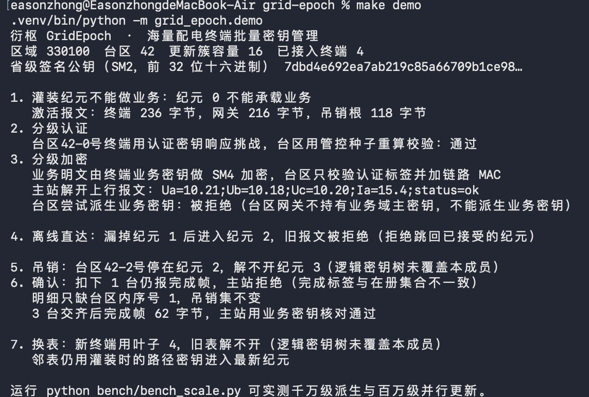

图 3-1　make demo 步骤 1—3：纪元 0 拒绝业务，分级认证通过，主站解开电能量，台区派生业务密钥被拒绝

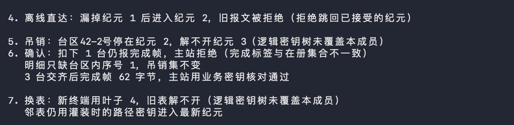

图 3-2　make demo 步骤 4：漏掉纪元 1 后进入纪元 2
`make split` 的步骤 1 同样是漏掉纪元 1 后进入纪元 2（图 3-3）。步骤 2 吊销旧表。步骤 3 中新表进入当前纪元，旧表维持吊销，邻表沿用灌装时的路径密钥进入同一纪元（图 3-4）。


图 3-3　make split 步骤 1：漏掉纪元 1 后进入纪元 2


图 3-4　make split 步骤 2—3：旧表吊销，新表进入，邻表沿用路径密钥
功能测试结果如下。
序号	测试项	预期结果	实测结果
1	纪元 0 业务拒绝	灌装纪元不承载业务	通过（图 3-1）
2	分级认证	管控链重算通过	通过（图 3-1）
3	电能量与越权派生	主站解开明文，台区派生业务密钥被拒绝	通过（图 3-1、图 2-5）
4	离线直达	漏收纪元 1 后进入纪元 2，旧报文拒绝	通过（图 3-2、图 3-3）
5	吊销隔离	被吊销终端解不开新纪元	通过（图 2-16、图 3-4）
6	完成帧一致性	扣下未吊销即拒绝，吊销集不变	通过（图 2-15）
7	换表与邻表	旧表吊销，新表与邻表进入新纪元	通过（图 2-19、图 3-4）
8	销毁	接入核验失败，重新灌装被拒绝，叶子不进吊销集	通过（图 2-21、图 2-23、图 2-24）
9	托管恢复	错口令拒绝，两份口令可以打开，页面不回传随机数	通过（图 2-10、图 2-11、图 2-12）
10	固件召回	版本 1 的四个批次进入吊销集，子集差 1 条	通过（图 2-27）
3.3 性能测试
`make bench` 的完整输出见图 3-5。正文表格与该图逐行一致。

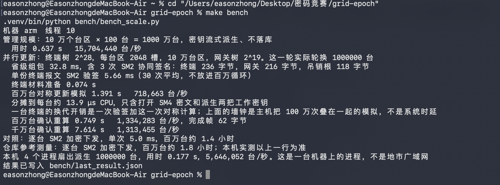

图 3-5　make bench：容量、组包、对称更新、确认重算、逐台 SM2 对照和本机 4 进程扇出
基准项	图 3-5 中的数值	备注
密钥流式派生	1000 万台 0.637 s，15,704,440 台/秒	不落库
4 进程扇出派生	100 万台 0.177 s，5,646,052 台/秒	本机进程，不是地市广域网
省级组包	32.8 ms	3 次 SM2 协同签名：终端 236 字节、网关 216 字节、吊销根 118 字节
单份终端报文验签	5.66 ms	30 次平均，不放进百万次循环
终端材料准备	0.074 s	本轮实际轮换 100 万台
百万台对称更新	1.391 s，718,663 台/秒	分摊每台约 13.9 μs
百万台确认重算	0.749 s，1,334,283 台/秒	完成帧 62 字节
千万台确认重算	7.614 s，1,313,455 台/秒	—
逐台 SM2 下发	单次 5.0 ms，百万台约 1.4 小时	仓库另一组参考测量约 1.8 小时
墙钟 1.391 秒是主机把 100 万次对称计算叠在一起的模拟，不是系统时延。一台终端的换代开销是一次验签（5.66 ms）加上约 13.9 μs 的对称计算。仓库 README 记录的另一次测量为：1000 万台派生 0.668 秒，百万台对称更新 1.462 秒，百万台确认重算 0.756 秒，千万台确认重算 7.926 秒，省级组包 38.1 毫秒，单份验签 6.32 毫秒，4 进程扇出 0.219 秒。两组量级一致。本报告的表格和图 3-5 用同一轮，不与 README 的那一轮混写。
3.4 测试数据与结果
图 3-6 中 `make test` 的结果是 Ran 43 tests in 18.000s，OK。图 3-7 中五个进程同时存在。

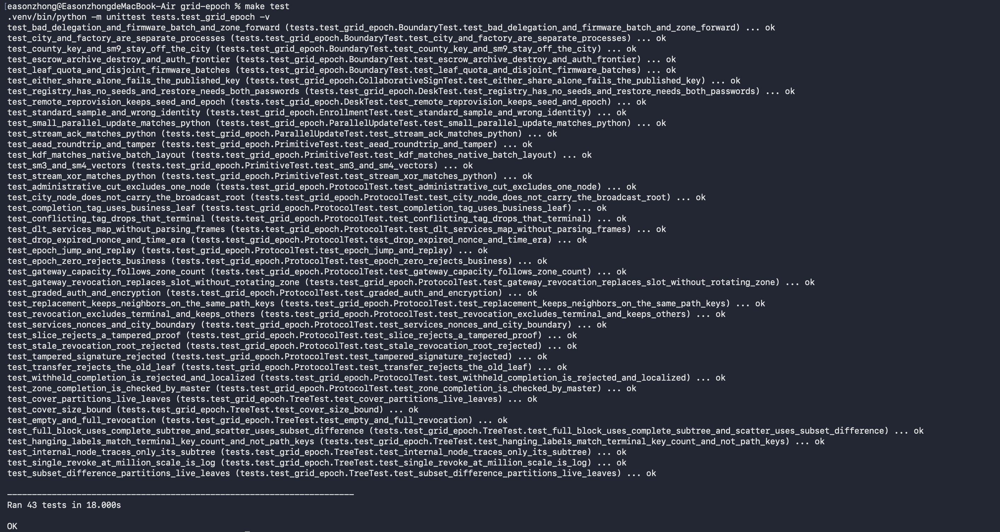

图 3-6　make test：Ran 43 tests，OK

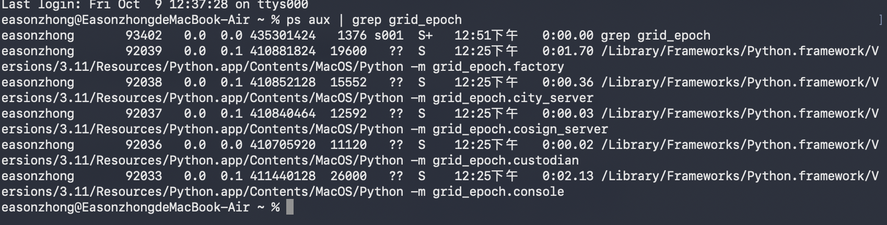

图 3-7　五个进程同框：console、city_server、factory、custodian、cosign_server
测试类别	测试内容	证据	结果
算法正确性	SM3/SM4 标准向量、AEAD 往返与篡改、流密钥一致性	图 3-6 原语类	通过
协议行为	纪元跳变与重放、过期随机数、旧吊销根、篡改签名、越权派生、完成帧	图 3-6 协议类，20 项	通过
树结构	空吊销与满吊销、完全子树与子集差、百万规模单叶吊销的对数覆盖族、悬挂标签数量	图 3-6 树类，8 项	通过
端到端功能	demo 与 split	图 3-1 至图 3-4	通过
规模性能	千万级派生、百万级更新与确认	图 3-5	与设计容量同一口径
部署	五进程同时存在	图 3-7	通过

4.应用前景
（1）配电侧的批量轮换。分布式光伏、充电桩和需求响应使终端数量继续增加。本系统把一轮轮换做成一份签名广播，终端用长期密钥打开最新纪元。本机测量里，百万台对称更新是秒级。落地时还要加上链路时延，数字不能直接当成广域网时延。
（2）失陷终端与漏收终端同时存在。子集差把失陷叶子排除出下一轮。整区、整县、整批可以各收成一条。漏收的在册终端不必补齐中间纪元。完成帧不一致时，主站把缺席定位到台区内序号，并且不因此自动吊销。固件按批次召回，召回单位是对齐的 64 叶，不是逐台下发停用指令。
（3）材料分开存放。电能量和完成标签用业务链，台区停在管控链上。设备私钥在产线，广播树根在省级软件模块，第三份门限分片在保管进程，协同签名的 d2 在单独进程。这些边界针对的是单进程失陷，不是对硬件密码机或内控审计的替代。
（4）同类表计。纪元、完全子树和子集差不依赖电能数据的字段含义。燃气、水务、热力里同样存在“多数终端漏收、少数终端必须退出”的密钥更新，可以复用这条广播结构。档案字段和上行服务号需要按那个行业重定，不能把本演示的 GE01、GE03 直接当成已经接入的行业协议。

5.结论
本作品针对海量配电终端的下发规模、吊销与漏收、密钥材料集中这三个问题，实现了“衍枢 GridEpoch”。主要结果如下。
1.纪元广播：每一纪元更新两个 16 字节随机数，主密钥不更换。终端用灌装时的长期密钥打开最新一份，漏掉的中间纪元不用补齐。无吊销时终端报文 236 字节、网关报文 216 字节、吊销根 118 字节。
2.覆盖：无吊销时节点 1 一条完全子树密文；整区、整县、整批各一条子集差。散点吊销的覆盖族随形状增长，单叶时为 O(log N) 条。终端靠 Merkle 只打开自己的一条。集中器只转发本台区切片，不另建密钥树。完成帧 62 字节，由业务叶子上的标签聚合成，台区算不出这个标签；终端对标签的 SM9 签名核验失败时，这 62 字节也不接受。确认失败不吊销。逻辑密钥层次和 GDOI 都不作为更新通道。
3.两套分片、五个进程：协同签名的 d1 与 d2 都不能单独签名。主密钥和纪元随机数是另一套 GF(256) 上的 2-of-3。产线打开种子，地市打不开；保管进程只收第三份。县序号来自注册槽。销毁、吊销和确认失败改的不是同一份状态。
4.本机测量：1000 万台派生 0.637 秒，百万台对称更新 1.391 秒，百万台确认重算 0.749 秒。相对逐台 SM2 下发的约 1.4 小时，对称更新约为 3600 倍。图 3-6 为 43 项测试全部通过。
上述数字是一台机器上的吞吐。主站是软件密码模块。协同签名和 SM9 都不写成已经符合尚未对照的标准全文。源码、测试和基准脚本已放在 https://github.com/munos1233/grid-epoch 。图 3-5 和图 3-6 可以由 `make bench` 与 `make test` 重跑；重跑后的秒数会有正常波动，报告表格应与当次截图一致。

6.参考文献
[1] Naor D, Naor M, Lotspiech J. Revocation and Tracing Schemes for Stateless Receivers. Advances in Cryptology — CRYPTO 2001.
[2] GM/T 0002 商用密码算法 SM4。本作品的业务加密和覆盖密文使用 SM4。
[3] GM/T 0003 商用密码算法 SM2。纪元头的验签使用 SM2。协同签名实现不标成符合 GM/T 0144。
[4] GM/T 0004 商用密码算法 SM3。杂凑、KDF 和 HMAC 使用 SM3，测试中核对了标准向量。
[5] Wong C K, Gouda M, Lam S S. Secure group communications using key graphs. IEEE/ACM Transactions on Networking, 2000, 8(1): 16–30. 逻辑密钥层次要逐跳更新，本作品不把它当作停电后的更新通道。
[6] IEC 62351-9:2023 Power systems management and associated information exchange — Data and communications security — Part 9: Cyber security key management for power system equipment. 其组密钥用 GDOI，本作品不把它当作千万终端的更新通道。
